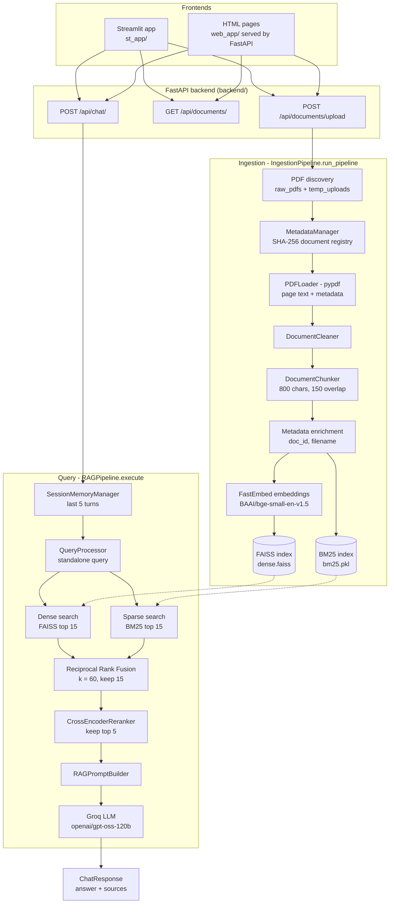
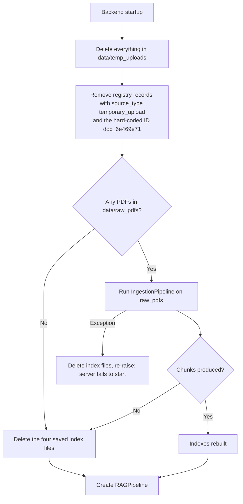

# Multi-PDF RAG — Hybrid RAG Assistant

A retrieval-augmented generation (RAG) application for asking questions across a collection of PDF documents. PDFs are extracted, cleaned, chunked and indexed twice: once as dense vectors (FAISS) and once as a keyword index (BM25). At question time both indexes are searched, the results are fused with Reciprocal Rank Fusion (RRF), reranked with a cross-encoder, and the top passages are sent to a Groq-hosted LLM. The API returns the answer together with the source chunks (file name, page, chunk ID, relevance score) that were given to the model.

The backend is a FastAPI service. Two interchangeable frontends are included: a Streamlit app and a set of plain HTML/CSS/JavaScript pages served by FastAPI itself.

Searching several PDFs at once is useful when the answer to a question is spread across reports, manuals or papers that you would otherwise search one by one. Hybrid retrieval is used because dense search handles paraphrased questions well, while keyword search catches exact terms, names and codes that embeddings can blur. Source metadata is returned with every answer so that claims can be checked against the original pages. The system prompt instructs the model to answer only from the supplied context, but this does not guarantee correct answers; verify important information against the cited sources.

## Table of Contents

- [Overview](#multi-pdf-rag--hybrid-rag-assistant)
- [Key Features](#key-features)
- [Architecture](#architecture)
- [Technology Stack](#technology-stack)
- [Repository Structure](#repository-structure)
- [Installation and Setup](#installation-and-setup)
- [Environment Variables](#environment-variables)
- [How the Application Works](#how-the-application-works)
- [Document Storage and Lifecycle](#document-storage-and-lifecycle)
- [API Reference](#api-reference)
- [Frontend Usage](#frontend-usage)
- [Retrieval and Configuration Parameters](#retrieval-and-configuration-parameters)
- [Troubleshooting](#troubleshooting)
- [Limitations and Future Improvements](#limitations-and-future-improvements)
- [Testing](#testing)
- [Screenshots](#screenshots)
- [License and Contributions](#license-and-contributions)

## Key Features

All items below were checked against the source code.

**Ingestion**

- Multi-PDF ingestion from two directories: `data/raw_pdfs/` (permanent) and `data/temp_uploads/` (temporary uploads).
- Page-by-page text extraction with `pypdf`; pages with no extractable text are skipped (there is no OCR).
- Text cleaning (null-byte removal, whitespace normalisation, dropping near-empty pages) and recursive character chunking with overlap.
- Document registry (`data/document_registry.json`) with SHA-256 file hashes used to detect files that are already registered.
- Chunk metadata includes source file, page number, chunk ID, file hash, document ID and source type.

**Retrieval and generation**

- Dense retrieval: FastEmbed embeddings stored in a FAISS inner-product index over L2-normalised vectors (cosine similarity).
- Sparse retrieval: BM25 (`BM25Okapi`) over regex-tokenised chunks.
- Reciprocal Rank Fusion to merge the two ranked lists.
- Cross-encoder reranking (FastEmbed `TextCrossEncoder`) with removal of duplicate passages.
- Contextual query rewriting: follow-up questions are rewritten into standalone queries with the Groq LLM when conversation history exists.
- Grounded answer generation with Groq, using a prompt that asks for `[Source: <chunk_id>]` citations.
- Session-based conversational memory (in-memory sliding window of the last 5 turns per session ID).

**Application**

- FastAPI REST endpoints for health, document listing, document upload and chat.
- Shared `RAGPipeline` instance created once at startup and injected into the chat route; the heavy synchronous work runs in a thread pool.
- Streamlit frontend (landing page, Home, PDF Documents, RAG Chat).
- HTML frontend served by FastAPI (`/`, `/home`, `/pdf`, `/chat`).
- Source metadata (file name, page, relevance score) shown in both chat interfaces.
- Startup routine that deletes temporary uploads and rebuilds the indexes from permanent PDFs (see [Document Storage and Lifecycle](#document-storage-and-lifecycle) for its limits).

**Present in the code but not wired up**

- `GroqLLMClient.generate_stream()` (token streaming) exists, but no route or frontend uses it.
- `SessionMemoryManager.clear_session()` exists, but no endpoint calls it.
- `src/evaluation/` and `tests/` contain empty files only; there is no evaluation or automated test code yet.

## Architecture



Notes on the diagram:

- Embeddings are generated inside `DenseIndexManager.build_and_save_index`, which is called by the ingestion pipeline after chunking and metadata enrichment. The BM25 index is built from the same ordered list of chunks.
- Dotted arrows show the indexes being read at query time. The retrievers load the index files from disk lazily on the first search and keep them in memory.
- `RESP` is returned to whichever frontend made the request. The query rewrite and the answer both call Groq; the rewrite is skipped when the session has no history.
- `GET /api/health/` and `GET /api/documents/{doc_id}` are omitted from the diagram for readability.

## Technology Stack

Library versions are **not pinned** in `requirements.txt`, so no versions are listed here. Python 3.10 or newer is required (inferred from `X | None` and `Path | str` annotations in the code; confirm against the version you develop with).

| Technology | Role in this project | Where |
|---|---|---|
| Python | Application language | whole repo |
| FastAPI + Uvicorn | REST API, static files, Jinja2-rendered HTML pages, lifespan startup | `backend/` |
| Pydantic / `pydantic-settings` | Request and response schemas; `.env`-backed settings | `backend/schemas/`, `config/settings.py` |
| Streamlit | Streamlit frontend | `st_app/` |
| HTML, CSS, vanilla JavaScript | HTML frontend; `marked` and `DOMPurify` (loaded from CDNs) render and sanitise Markdown answers | `web_app/` |
| `pypdf` | PDF text extraction | `src/ingestion/pdf_loader.py` |
| LangChain (`langchain_core`, `langchain_text_splitters`, `langchain_community`) | `Document` objects, `RecursiveCharacterTextSplitter`, `FastEmbedEmbeddings` wrapper | `src/ingestion/`, `src/embeddings/` |
| FastEmbed (ONNX Runtime) | Embedding model and cross-encoder reranker, run locally on CPU | `src/embeddings/`, `src/generation/reranker.py` |
| FAISS (`faiss`) | Dense vector index (`IndexFlatIP` wrapped in `IndexIDMap`) | `src/retrieval/dense_index.py` |
| `rank_bm25` | BM25 sparse index (`BM25Okapi`) | `src/retrieval/sparse_index.py` |
| Groq API (`groq` SDK) | LLM for answers and query rewriting | `src/generation/llm_client.py` |
| `requests` | Streamlit pages calling the FastAPI backend | `st_app/pages/` |
| NumPy | Embedding matrices for FAISS | `src/retrieval/dense_index.py` |

Configured models (from `config/settings.py`, verified):

| Purpose | Setting | Default |
|---|---|---|
| Embeddings | `EMBEDDING_MODEL_NAME` | `BAAI/bge-small-en-v1.5` |
| Reranker | `RERANKER_MODEL_NAME` | `Xenova/ms-marco-MiniLM-L-6-v2` |
| LLM (Groq) | `GROQ_MODEL_NAME` | `openai/gpt-oss-120b` |

> [!WARNING]
> **Dependency file is incomplete (needs your confirmation).** The code imports `faiss`, `rank_bm25` and `groq`, none of which are listed in `requirements.txt`. `requests`, `numpy`, `jinja2` and `langchain_text_splitters` are also imported but not listed; they may arrive transitively through other packages, but this could not be checked offline. See [Installation and Setup](#installation-and-setup).

## Repository Structure

`__init__.py` files are omitted. `data/` and `logs/` are created at runtime and are git-ignored, so they will not exist in a fresh clone.

```text
Hybrid-RAG-System/
├── backend/
│   ├── main.py                  # FastAPI app, startup cleanup, CORS, static files, HTML routes
│   ├── dependencies.py          # get_rag_pipeline() dependency (503 if pipeline missing)
│   ├── routes/
│   │   ├── chat.py              # POST /api/chat/
│   │   ├── documents.py         # document upload, list, get-by-id
│   │   └── health.py            # GET /api/health/
│   └── schemas/
│       ├── chat_schema.py       # ChatRequest, SourceChunk, ChatResponse
│       └── document_schema.py   # DocumentInfo, DocumentListResponse, UploadResponse
├── config/
│   └── settings.py              # Pydantic settings, defaults, directory creation
├── src/
│   ├── ingestion/
│   │   ├── ingestion_pipeline.py  # Orchestrates the full ingestion and indexing run
│   │   ├── pdf_loader.py          # pypdf extraction into LangChain Documents
│   │   ├── cleaner.py             # Text normalisation
│   │   ├── chunker.py             # RecursiveCharacterTextSplitter, chunk IDs
│   │   └── meta_manager.py        # Document registry and file hashing
│   ├── embeddings/
│   │   └── embedding_model.py     # Singleton FastEmbed embedding wrapper
│   ├── retrieval/
│   │   ├── dense_index.py         # FAISS build, save, load, search
│   │   ├── sparse_index.py        # BM25 build, save, load, search
│   │   ├── hybrid_fusion.py       # Reciprocal Rank Fusion
│   │   └── retriever.py           # Runs dense + sparse search, then fusion
│   ├── generation/
│   │   ├── reranker.py            # Cross-encoder reranking and de-duplication
│   │   ├── prompt_templates.py    # System prompt and context formatting
│   │   └── llm_client.py          # Groq client (blocking and streaming methods)
│   ├── orchestration/
│   │   ├── rag_pipeline.py        # End-to-end query pipeline (RAGPipeline.execute)
│   │   ├── query_processor.py     # Follow-up query rewriting
│   │   └── memory.py              # In-memory session history
│   ├── utils/
│   │   ├── helpers.py             # time_it decorator, MD5 helper
│   │   ├── logger.py              # Console + rotating file logger
│   │   └── logger_structure.txt   # ASCII note describing the logger
│   └── evaluation/                # Empty placeholder modules
├── st_app/
│   ├── app.py                   # Streamlit entry point and page navigation
│   ├── pages/                   # home.py, pdf.py, chat.py
│   └── assets/app_icon.png
├── web_app/
│   ├── templates/               # index.html, home.html, pdf.html, chat.html
│   └── static/                  # css/, js/, images/app_icon.png
├── tests/                       # Four empty test files (no tests yet)
├── debug_retrieval.py           # Ad-hoc retrieval/rerank inspection script (hard-coded query)
├── STRUCTURE.md                 # ASCII architecture sketch (see note below)
├── requirements.txt
└── .gitignore
```

`STRUCTURE.md` is an older conceptual sketch. It mentions Hugging Face embeddings and "PDF / Web Sources"; the implemented code uses FastEmbed and PDF files only, so treat `README.md` as the reference.

## Installation and Setup

These steps target **Windows with Command Prompt** (`cmd`).

**1. Clone the repository and open it**

```bat
git clone https://github.com/M-Sudheer18/Hybrid-RAG-System.git
cd Hybrid-RAG-System
```

The folder name is only a local choice (the project has been developed in a folder called `Multi_PDF_Rag`). Run every backend command from this project root: both the Python imports (`config`, `src`, `backend`) and the `.env` lookup depend on the working directory.

**2. Create and activate a virtual environment**

```bat
python -m venv venv
venv\Scripts\activate
```

**3. Install dependencies**

```bat
pip install -r requirements.txt
pip install faiss-cpu rank_bm25 groq
```

The second command installs packages that the code imports but `requirements.txt` does not list. `faiss-cpu` is the usual CPU build that provides `import faiss`; confirm that it suits your machine. If you see `ModuleNotFoundError` for `requests`, `numpy`, `jinja2` or `langchain_text_splitters`, install the named package as well.

**4. Configure environment variables**

Create a file named `.env` in the project root (it is git-ignored):

```env
GROQ_API_KEY=your_groq_api_key_here
```

Get a key from the Groq Cloud console. Never commit this file. See [Environment Variables](#environment-variables) for optional settings.

**5. (Optional) Add permanent PDFs**

Copy PDFs into `data/raw_pdfs/` (created on first run). These are indexed at every backend startup. PDFs uploaded through the UI are temporary; see [Document Storage and Lifecycle](#document-storage-and-lifecycle).

**6. Start the FastAPI backend** (first terminal, project root)

```bat
uvicorn backend.main:app --host 127.0.0.1 --port 8000 --reload
```

`python -m backend.main` also works; it binds `0.0.0.0:8000` with reload enabled. On the first run, FastEmbed is expected to download the embedding and reranker models, which needs an internet connection (library behaviour, not verified here). Startup also rebuilds the indexes from `data/raw_pdfs/`, so it can take a while with many PDFs.

**7. Start Streamlit** (second terminal)

```bat
cd Hybrid-RAG-System
venv\Scripts\activate
cd st_app
streamlit run app.py
```

Streamlit must be started from inside `st_app`, because `app.py` imports `pages.home`, `pages.pdf` and `pages.chat` as top-level modules. If the backend is not at `http://127.0.0.1:8000`, set the URL before launching:

```bat
set FASTAPI_BASE_URL=http://127.0.0.1:8000
```

**8. Open the application**

| What | URL |
|---|---|
| HTML frontend (landing page) | `http://127.0.0.1:8000/` |
| FastAPI Swagger documentation | `http://127.0.0.1:8000/docs` |
| Streamlit frontend | `http://localhost:8501` (Streamlit's default port; the code does not set one) |

## Environment Variables

Settings are defined in `config/settings.py` using `pydantic-settings`; values are read from the process environment or from a `.env` file in the working directory, and unknown keys are ignored. Variable names match the field names (matching is case-insensitive by default in `pydantic-settings`).

| Variable | Purpose | Required | Default |
|---|---|---|---|
| `GROQ_API_KEY` | Groq Cloud API key | **Yes** (see below) | none |
| `GROQ_MODEL_NAME` | Groq model for answers and query rewriting | No | `openai/gpt-oss-120b` |
| `TEMPERATURE` | LLM sampling temperature | No | `0.0` |
| `MAX_TOKENS` | Maximum completion tokens for answers | No | `2048` |
| `EMBEDDING_MODEL_NAME` | FastEmbed embedding model | No | `BAAI/bge-small-en-v1.5` |
| `RERANKER_MODEL_NAME` | FastEmbed cross-encoder model | No | `Xenova/ms-marco-MiniLM-L-6-v2` |
| `CHUNK_SIZE` | Maximum characters per chunk | No | `800` |
| `CHUNK_OVERLAP` | Overlap between chunks (must be smaller than `CHUNK_SIZE`) | No | `150` |
| `TOP_K_SEARCH` | Dense (FAISS) results per query | No | `15` |
| `TOP_K_SPARSE` | Sparse (BM25) results per query | No | `15` |
| `TOP_N_RERANK` | Chunks kept after reranking and sent to the LLM | No | `5` |
| `RRF_K_CONSTANT` | RRF smoothing constant | No | `60` |
| `FASTAPI_BASE_URL` | Backend URL used by the **Streamlit** app (read with `os.getenv`, not part of `Settings`) | No | `http://127.0.0.1:8000` |

`PROJECT_NAME` and `VERSION` also exist in `Settings` but are not used elsewhere that was checked. Path settings (`DATA_DIR`, `RAW_PDF_DIR`, `VECTOR_STORE_DIR`, `FAISS_INDEX_DIR`, `BM25_INDEX_DIR`, and others) can technically be overridden, but the defaults of the dependent paths are computed from the repository root, and several modules build `data/raw_pdfs` and `data/temp_uploads` from `DATA_DIR` directly. Leave the path settings alone unless you have tested the combination.

`MAX_HISTORY_TURNS` is read in `src/orchestration/memory.py` via `getattr(settings, ...)`, but it is not a declared setting, so it cannot be changed through `.env`; the effective value is always `5`.

**Behaviour without an API key.** `Settings` only prints a warning when `GROQ_API_KEY` is missing. However, the backend's startup creates `RAGPipeline`, which creates `QueryProcessor` and `GroqLLMClient`, and the latter raises a `ValueError` when the key is absent. The lifespan handler converts this into `RuntimeError: Failed to initialize the application.`, so **the FastAPI server does not start without a key**. The Streamlit app starts, but cannot reach the backend. (The startup cleanup and index rebuild run before the key check and do not need Groq.)

## How the Application Works

1. **PDF discovery and loading.** `IngestionPipeline.run_pipeline()` lists every `.pdf` in `data/raw_pdfs/` and `data/temp_uploads/` (sorted by path). Each file is hashed with SHA-256 and registered if its hash is new.
2. **Text extraction.** `PDFLoader` reads each file with `pypdf` and creates one LangChain `Document` per page that has text. Metadata: `source` (file name), `page` (1-based), `file_hash`, `source_type`. Pages without extractable text, such as scanned images, are skipped; there is no OCR.
3. **Cleaning and chunking.** `DocumentCleaner` removes null bytes, collapses all whitespace to single spaces and drops pages with 10 characters or fewer. `DocumentChunker` uses `RecursiveCharacterTextSplitter` (separators `"\n\n"`, `"\n"`, `". "`, `" "`, `""`), then assigns `chunk_index` and `chunk_id` in the form `<filename>_chunk_<n>`. Because the cleaner collapses all whitespace (including newlines) into single spaces, the `"\n\n"` and `"\n"` separators have nothing to match, so splitting effectively happens at `". "`, at spaces, or at individual characters.
4. **Registration and metadata enrichment.** Each chunk gets its `doc_id` (looked up from its file hash) and a `filename`. After indexing, each document's `chunk_count` and `status` (`completed`) are written to the registry.
5. **Embedding generation.** `DenseIndexManager.build_and_save_index` embeds every chunk with the FastEmbed model, L2-normalises the vectors, and stores them in `IndexFlatIP` wrapped in `IndexIDMap`. Inner product on normalised vectors equals cosine similarity.
6. **Dense retrieval.** The query is embedded and normalised the same way and the top `TOP_K_SEARCH` chunks are returned with a `dense_score`.
7. **Sparse retrieval.** `SparseIndexManager` tokenises text with a lower-cased `\b\w+\b` regex, builds a `BM25Okapi` model, and returns the top `TOP_K_SPARSE` chunks with a positive `sparse_score`.
8. **Fusion (RRF).** `HybridRetriever.apply_rrf` scores each chunk as the sum of `1 / (k + rank)` across both lists (`k = RRF_K_CONSTANT`) and keeps the top 15. In `RAGPipeline.execute` the fusion output size is hard-coded to `15`; it is not a setting.
9. **Reranking.** `CrossEncoderReranker` scores the fused candidates against the query, sorts them, removes passages with identical normalised text, and keeps `TOP_N_RERANK` chunks. If the model call fails, it falls back to the fused order (de-duplicated).
10. **Prompt construction.** `RAGPromptBuilder` builds a system message (answer only from context, cite `[Source: <chunk_id>]`, do not invent source IDs, say so if the answer is not in the context) and a user message containing the standalone query and the chunks wrapped in `BEGIN CHUNK` / `END CHUNK` markers.
11. **Answer generation.** `GroqLLMClient.generate` sends a blocking chat completion to Groq with `TEMPERATURE`, `MAX_TOKENS`, `reasoning_effort="medium"` and `include_reasoning=False`.
12. **Sources and response.** The API returns the answer plus one `sources` entry per reranked chunk: `chunk_id`, `score` (the cross-encoder score) and the chunk `metadata`. Both frontends render file name, page and score.
13. **Conversational context.** `SessionMemoryManager` keeps a `deque` of the last 5 turns (10 messages) per `session_id`, in process memory. For follow-up questions, `QueryProcessor` asks Groq (temperature 0.0, 128 max tokens, low reasoning effort) to rewrite the question into a standalone query; with no history it skips the LLM call, and if the rewrite fails it falls back to the original question. The original (not rewritten) question and the answer are stored in memory.

**Dense versus sparse retrieval.** Dense retrieval compares meaning: the question and every chunk are converted to vectors, so a chunk can match even when it shares no words with the question. Sparse retrieval (BM25) compares words: chunks score highly when they contain the query's terms, weighted by how rare those terms are, which suits exact names, identifiers and codes. Their scores are on different scales, which is why RRF fuses by rank rather than by raw score.

**Index persistence and startup.** Index files are written to `data/vector_store/` after every ingestion run. The retrievers load them lazily from disk on first search and then keep them in memory. At every backend startup, however, `cleanup_temporary_uploads()` rebuilds the indexes from `data/raw_pdfs/` instead of reusing the saved files (details in the next section).

## Document Storage and Lifecycle

| Location | Contents | Verified source |
|---|---|---|
| `data/raw_pdfs/` | Permanent PDFs (placed there manually) | `config/settings.py`, `ingestion_pipeline.py` |
| `data/temp_uploads/` | PDFs uploaded through the API/UI | `routes/documents.py`, `main.py` |
| `data/document_registry.json` | Document metadata registry | `meta_manager.py` |
| `data/vector_store/faiss_index/` | `dense.faiss`, `metadata.json` | `dense_index.py` |
| `data/vector_store/bm25_index/` | `bm25.pkl`, `metadata.json` | `sparse_index.py` |
| `logs/rag_pipeline.log` | Rotating log (5 MB, 3 backups) | `src/utils/logger.py` |

`settings.py` also creates `data/scraped_data/`, `data/processed/` and `data/metadata/`, but nothing in the code reads or writes them.

**Permanent versus temporary.** Only files in `data/raw_pdfs/` are permanent, with `source_type` `pdf`. No API endpoint or UI writes there; copy files in yourself. Every upload goes to `data/temp_uploads/` with `source_type` `temporary_upload`. If the same file name already exists in `temp_uploads/`, the new file is saved as `<name>_<8 hex chars>.pdf`.

**Upload flow.** After saving the file, the upload route runs the whole ingestion pipeline in a thread pool. This **re-reads, re-embeds and rebuilds both indexes for every PDF in both directories**, not just the new file. It then looks the new file up in the registry by hash and returns that record's status.

**Startup flow.** `cleanup_temporary_uploads()` runs inside the FastAPI lifespan, before `RAGPipeline` is created:



What this means in practice:

- **Temporary files are removed on restart**, together with their registry records. This is a best-effort routine in the startup path: any exception while deleting files or pruning the registry propagates out of the lifespan handler and stops the server from starting. It runs only at startup, never while the server is running.
- **No permanent PDFs.** The saved index files are deleted and the server still starts. Chat then finds no index, retrieval returns nothing, and the model is called with the placeholder context `No relevant context found.`.
- **Rebuild failure.** If rebuilding raises, the index files are deleted (so stale indexes are never served) and the exception is re-raised, which makes startup fail. If rebuilding produces zero chunks, the index files are deleted and startup continues.
- **Registry updates.** Records are created with status `processing` and `chunk_count` 0, and set to `completed` with the chunk count once indexing succeeds. The code never sets any other status (the schema descriptions mention `chunked`, `failed` and `skipped`, but these are not used).
- **Duplicates.** Registration is keyed on the SHA-256 hash. A file whose content is already registered is not registered again, even under a different name, and shares the existing `doc_id`. Its pages are still extracted and indexed again, which can create duplicate chunks; the reranker removes identical passages from the final context.
- **Stale records.** Startup prunes only temporary-upload records. If you remove a permanent PDF from `data/raw_pdfs/`, its registry record stays and is still listed with status `completed` even though it is no longer indexed. Delete the record from `data/document_registry.json` manually if needed.
- **Hard-coded ID.** `main.py` removes the record `doc_6e469e71` on every startup, apparently a leftover from development. The log message also refers to "AI&ML" records. This needs your review before publishing.

## API Reference

Base URL: `http://127.0.0.1:8000`. Interactive documentation is generated at `/docs`. Routers are declared with a trailing `/` for the collection routes, so use the exact paths below (without the slash FastAPI would redirect to the slash form by default).

| Method | Path | Purpose |
|---|---|---|
| `GET` | `/api/health/` | Liveness and pipeline status |
| `GET` | `/api/documents/` | List registered documents |
| `POST` | `/api/documents/upload` | Upload and index a PDF (temporary) |
| `GET` | `/api/documents/{doc_id}` | Get one document's registry record |
| `POST` | `/api/chat/` | Ask a question |

### `GET /api/health/`

Response `200`:

```json
{ "status": "healthy", "pipeline_payload": true }
```

`pipeline_payload` is `true` once the shared `RAGPipeline` is attached to the app (the key name is as implemented).

### `GET /api/documents/`

Response `200`:

```json
{
  "documents": [
    {
      "doc_id": "doc_1a2b3c4d",
      "file_name": "report.pdf",
      "file_hash": "<sha-256 hex digest>",
      "source_type": "pdf",
      "ingestion_time": "2026-01-01T09:30:00+00:00",
      "status": "completed",
      "chunk_count": 42
    }
  ],
  "total_count": 1
}
```

`source_type` is `pdf` for permanent files and `temporary_upload` for uploads. Errors: `500` with `"Could not retrieved the Document List"`.

### `POST /api/documents/upload`

Multipart form data with a single file field named **`file`**. Only file names ending in `.pdf` are accepted.

```bat
curl -X POST "http://127.0.0.1:8000/api/documents/upload" -F "file=@C:\path\to\document.pdf"
```

Response `200`:

```json
{
  "message": "Temporary PDF successfully indexed.",
  "doc_id": "doc_1a2b3c4d",
  "filename": "document.pdf",
  "status": "completed",
  "chunk_count": 42
}
```

When `status` is not `completed`, `message` is `"PDF Processing Status: <status>"` and the HTTP status is still `200`. `filename` is the sanitised name you uploaded.

| Status | `detail` |
|---|---|
| `400` | `Only Pdf Files are Allowed` |
| `422` | Standard FastAPI validation error (no `file` field) |
| `500` | `Could not save the uploaded PDF.` |
| `500` | `PDF was saved, but its metadata was not registered.` |
| `500` | `PDF was saved, but indexing failed.` |

The request blocks until the indexes have been rebuilt.

### `GET /api/documents/{doc_id}`

Returns one object shaped like an item of `documents` above. Error: `404` with `Document with ID '<doc_id>' not found.`

### `POST /api/chat/`

Request body (JSON):

```json
{
  "session_id": "demo-session-1",
  "query": "What are the main findings of the report?"
}
```

```bat
curl -X POST "http://127.0.0.1:8000/api/chat/" -H "Content-Type: application/json" -d "{\"session_id\": \"demo-session-1\", \"query\": \"What are the main findings of the report?\"}"
```

Response `200`:

```json
{
  "session_id": "demo-session-1",
  "original_query": "What are the main findings of the report?",
  "standalone_query": "What are the main findings of the report?",
  "answer": "… [Source: report.pdf_chunk_7]",
  "sources": [
    {
      "chunk_id": "report.pdf_chunk_7",
      "score": 4.21,
      "metadata": {
        "source": "report.pdf",
        "page": 3,
        "file_hash": "<sha-256 hex digest>",
        "source_type": "pdf",
        "chunk_index": 7,
        "chunk_id": "report.pdf_chunk_7",
        "doc_id": "doc_1a2b3c4d",
        "filename": "report.pdf"
      }
    }
  ]
}
```

The values above are illustrative. `score` is the cross-encoder score of the chunk; `metadata` is the chunk metadata produced by ingestion. Use the same `session_id` across requests to keep conversational context.

| Status | Cause |
|---|---|
| `400` | `session_id` or `query` is empty or whitespace only (raised inside the pipeline) |
| `422` | Missing field or wrong type (FastAPI validation) |
| `500` | Any other failure, e.g. a Groq API error; `detail` is `An Internal error Occurs while processing request..` |
| `503` | The RAG pipeline is not attached to the app state |

## Frontend Usage

Both frontends use the same API endpoints.

### Streamlit (`st_app/`)

Start it as described in [Installation and Setup](#installation-and-setup). It reads the backend URL from `FASTAPI_BASE_URL` (default `http://127.0.0.1:8000`). Navigation is hidden; the pages are linked with in-page buttons that switch `st.session_state.current_page`.

| Page | What it does |
|---|---|
| Welcome (landing) | Intro text, **Get started** (opens Home) and **Read the docs** (opens `<backend>/docs`) |
| Home | Cards leading to PDF Documents and RAG Chat; a caption shows how many registered documents have status `completed` (from `GET /api/documents/`) |
| PDF Documents | Lists documents as cards (file name and status); a PDF uploader and **Analyze File** button that call `POST /api/documents/upload` (300 s timeout) |
| RAG Chat | Question box that calls `POST /api/chat/` (180 s timeout); answers render as Markdown; a **Sources used** expander lists file name, page and relevance score per source |

Chat behaviour: a UUID `session_id` is created per Streamlit session and sent with every question. **+ New Chat** generates a new UUID and clears the on-screen history; the old session's memory stays in the backend process until it restarts. The chat page does not check whether any documents exist, and any 2xx upload response is reported as "PDF processed successfully", even if the returned status is not `completed`.

### HTML frontend (`web_app/`)

Served by the FastAPI backend itself, so no separate process is needed.

| URL | Template | Purpose |
|---|---|---|
| `/` | `index.html` | Landing page |
| `/home` | `home.html` | Dashboard with the total document count (`total_count`) |
| `/pdf` | `pdf.html` | Document list and drag-and-drop or click upload |
| `/chat` | `chat.html` | Chat with Markdown answers and a Sources list (chunk ID, file, page, score) |
| `/docs` | (FastAPI) | Swagger UI |

- **Static assets** are mounted at `/static` from `web_app/static/` (`css/`, `js/`, `images/`). Templates reference them with `url_for('static', path=...)`.
- **Favicon.** Each template sets `<link rel="icon" href="/static/images/app_icon.png">`. There is no `/favicon.ico` route.
- **Communication.** The JavaScript uses same-origin `fetch` calls to `/api/documents/`, `/api/documents/upload` and `/api/chat/`, so no backend URL needs configuring.
- **Chat behaviour.** The input stays disabled until at least one document with status `completed` exists. The session ID is stored in `sessionStorage`; **Clear Chat** only starts a new session ID in the browser.
- **External resources.** The pages load Google Fonts, and the chat page loads `marked` and `DOMPurify` from CDNs, so those need internet access in the browser.

Neither interface offers document deletion or renaming, and both treat uploads as temporary. No UI elements were found that are purely decorative.

## Retrieval and Configuration Parameters

Defaults come from `config/settings.py`.

| Parameter | Default | Effect |
|---|---|---|
| `CHUNK_SIZE` | 800 characters | Larger chunks carry more context per passage but make retrieval less precise and use more prompt space. |
| `CHUNK_OVERLAP` | 150 characters | Reduces the chance that an answer is split across a chunk boundary; more overlap means more (partly duplicated) chunks. Must be smaller than `CHUNK_SIZE`. |
| `TOP_K_SEARCH` | 15 | Number of dense candidates. Higher values improve recall at a small cost in speed. |
| `TOP_K_SPARSE` | 15 | Number of keyword candidates. |
| RRF fusion output | 15 (hard-coded in `rag_pipeline.py`) | Size of the candidate pool passed to the reranker. Not configurable through settings. |
| `RRF_K_CONSTANT` | 60 | Smoothing constant in `1 / (k + rank)`; larger values flatten the difference between top ranks. |
| `TOP_N_RERANK` | 5 | Number of chunks placed in the LLM prompt; drives context size and cost. |
| `TEMPERATURE` | 0.0 | Deterministic, factual-leaning generation. |
| `MAX_TOKENS` | 2048 | Upper bound on answer length. Query rewriting uses its own limit of 128. |

## Troubleshooting

These are possibilities derived from the code, not confirmed issues. The log file `logs/rag_pipeline.log` (and the console running Uvicorn) usually shows the cause.

| Symptom | Possible cause and fix |
|---|---|
| Backend exits at startup with `Failed to initialize the application.` | Most likely `GROQ_API_KEY` is missing or `.env` is not in the directory you launched from. Create `.env` in the project root and start Uvicorn from there. Other startup errors (model download, index rebuild) show in the log. |
| Streamlit shows "I couldn't connect to the FastAPI backend" or "Could not load your knowledge base" | The backend is not running or `FASTAPI_BASE_URL` points elsewhere. Open `http://127.0.0.1:8000/api/health/` to check. |
| Browser pages say "Could not connect to the document service" | The backend is not running, or the page was opened from another origin. Use `http://127.0.0.1:8000/`. |
| Answers say the information is unavailable even though a PDF is loaded | The FAISS or BM25 files may be missing or invalid, so retrieval returned nothing. Dense and sparse failures are caught and logged, so no HTTP error appears. Check the log for `FAISS index or metadata is missing`, `BM25 index or Metadata Store Was Missing`, or consistency errors, then restart the backend to rebuild from `data/raw_pdfs/`. |
| Documents uploaded earlier in the session are not searchable | The running retriever keeps the index it loaded first in memory and the upload route does not reload it (see [Limitations](#limitations-and-future-improvements)). Restarting the backend reloads the files, but note that restarting also deletes temporary uploads. |
| Upload returns `400` | The file name does not end in `.pdf`. |
| Upload returns `500` ("saved, but indexing failed") | Check the log for the exception, for instance a model that failed to load or a corrupt PDF. |
| Upload finishes but status stays `processing` with 0 chunks | No text could be extracted (for example a scanned PDF; there is no OCR) or the file failed to load. |
| A document is listed but is not searchable | Its registry record may be stale (the PDF was removed from `data/raw_pdfs/`, and startup only prunes temporary-upload records). Remove the record from `data/document_registry.json` or put the file back in `data/raw_pdfs/` and restart. |
| A PDF uploaded through the UI disappeared after restart | Expected: uploads are temporary. Copy the file to `data/raw_pdfs/` to keep it. |
| `ModuleNotFoundError` (`faiss`, `rank_bm25`, `groq`, `requests`, …) | Install the missing package; see step 3 of [Installation and Setup](#installation-and-setup). |
| `ModuleNotFoundError: pages` when starting Streamlit | Run `streamlit run app.py` from inside `st_app`. |
| `ModuleNotFoundError: config` or `src` | Run Uvicorn from the project root, with the virtual environment active. |
| Port 8000 or 8501 already in use | Find the process with `netstat -ano \| findstr :8000`, then `taskkill /PID <pid> /F`, or choose another port (`--port 8001`, `streamlit run app.py --server.port 8502`) and update `FASTAPI_BASE_URL` accordingly. |

## Limitations and Future Improvements

### Existing limitations (from the code)

- **Session memory is in-process.** Histories are lost on restart, grow with the number of sessions, and cannot be cleared through the API.
- **No authentication or user isolation.** All users share one knowledge base; `session_id` is chosen by the client. CORS is configured with `allow_origins=["*"]` and `allow_credentials=True` (the code comment notes it should be restricted for production).
- **Uploads are temporary and indexing is synchronous.** Every upload re-embeds all PDFs and rebuilds both indexes inside the request. There is no background job queue and no protection against concurrent uploads.
- **Running retriever does not reload indexes.** Each index manager loads its files once, when its in-memory index is still empty. Nothing reloads them after an upload, so documents uploaded after the first successful search may not be searchable until the next restart. This follows from reading the code and has not been tested.
- **Startup rebuilds instead of reusing indexes**, so startup time grows with the size of `data/raw_pdfs/`.
- **No document deletion**, no pruning of registry records for removed permanent PDFs, and a hard-coded document ID in the startup cleanup.
- **Minimal upload validation.** Only the file extension is checked; there is no size limit or content check.
- **No OCR.** Scanned PDFs yield no chunks; their registry status stays `processing` and the upload endpoint still returns HTTP 200 (both frontends then show a success message).
- **Chunk IDs are built from file names.** A permanent and a temporary PDF with the same file name would produce identical chunk IDs, which could be merged during fusion. Not tested.
- **Reranker fallback path.** If the reranker call fails, chunks have no `cross_encoder_score`; `SourceChunk.score` is a required `float`, so the response would likely fail validation and return `500`. Not tested.
- **Frontend details.** `web_app/static/js/pdf.js` inserts `file_name` into the page with `innerHTML` without escaping (the Streamlit page escapes it). The HTML chat page depends on CDNs.
- **Retrieval quality is unmeasured.** There is no evaluation code, and no tests (see [Testing](#testing)).
- **Dependencies are unpinned and incomplete** (see [Technology Stack](#technology-stack)). There is no Dockerfile, CI configuration or deployment configuration. The `__main__` runner in `backend/main.py` uses `reload=True` and binds `0.0.0.0`, which is a development setup.
- **Stale demo blocks.** For example, the `__main__` block in `src/ingestion/pdf_loader.py` passes `directory_paths=`, but the constructor parameter is `directory_path`.
- The BM25 index is stored with `pickle`; only load index files you created yourself.

### Suggested improvements (not implemented)

- Persist conversation history (database or Redis) and add a clear-session endpoint.
- Add authentication, per-user document scopes and a restricted CORS policy.
- Add a delete endpoint that keeps the registry and both indexes consistent; reload indexes after ingestion.
- Ingest incrementally and in the background; add upload size and content validation.
- Add OCR for scanned PDFs and a `failed` status for unreadable files.
- Use the existing streaming generator for token streaming in the UI.
- Add retrieval and answer evaluation (the empty `src/evaluation/` modules are a natural home) and a real test suite.
- Pin dependencies, complete `requirements.txt`, and add a Dockerfile and CI.

## Testing

The four files in `tests/` (`test_api.py`, `test_ingestion.py`, `test_rag_pipeline.py`, `test_retrieval.py`) are **empty (0 bytes)**, and `pytest` is not listed in `requirements.txt`. There is currently no automated test suite, no coverage figure and no benchmark or evaluation result for this project.

Some modules contain small `if __name__ == "__main__":` demonstration blocks, but several of them use sample data unrelated to this project, and at least one (`pdf_loader.py`) has an outdated argument name, so do not rely on them as tests.

**Manual smoke-test checklist** (not an automated check):

1. Start the backend and confirm `GET http://127.0.0.1:8000/api/health/` returns `"pipeline_payload": true`.
2. Open `http://127.0.0.1:8000/docs` and confirm the five routes are listed.
3. Upload a text-based PDF with `POST /api/documents/upload` and confirm `status` is `completed` and `chunk_count` is greater than 0.
4. Call `GET /api/documents/` and confirm the document appears with the same `doc_id`.
5. Ask a question that the PDF answers via `POST /api/chat/`; check the `sources` pages against the PDF.
6. Ask a follow-up using a pronoun with the same `session_id`; check that `standalone_query` differs from `original_query`.
7. Restart the backend and confirm that `data/temp_uploads/` is empty and the temporary document no longer appears in the list.
8. Place a PDF in `data/raw_pdfs/`, restart, and confirm it is listed and searchable.

Optionally, `python debug_retrieval.py` (run from the project root, after indexes exist) prints the reranked chunks for a hard-coded query; edit the `query` variable first.

## Screenshots

No screenshots are committed to the repository yet. Suggested additions (store them in a folder such as `docs/screenshots/`, which does not exist yet, and link them here):

| Screenshot | Suggested file name | Status |
|---|---|---|
| Landing page | `docs/screenshots/landing.png` | To add |
| PDF documents dashboard | `docs/screenshots/pdf-documents.png` | To add |
| Chat answer with sources expanded | `docs/screenshots/chat-sources.png` | To add |

## License and Contributions

**License.** No license file exists in the repository, so no license is declared. Until the owner adds one, the terms for reuse are unspecified.

**Contributing.** Contributions are welcome in the form of issues and pull requests.

1. Fork the repository and create a feature branch.
2. Keep changes within the existing module layout (`backend/`, `src/`, `st_app/`, `web_app/`).
3. Because there is no automated test suite yet, describe how you verified your change (for example by running the [smoke-test checklist](#testing)); adding tests is encouraged.
4. Never commit `.env`, API keys, `data/` or `logs/`; these are git-ignored.
5. Open a pull request describing the change and its motivation.